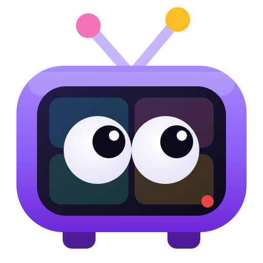
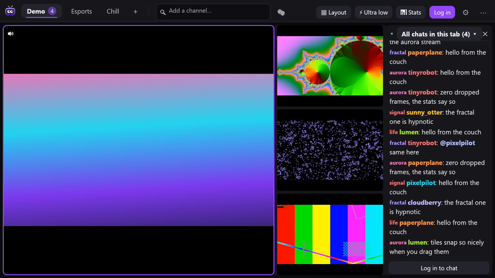
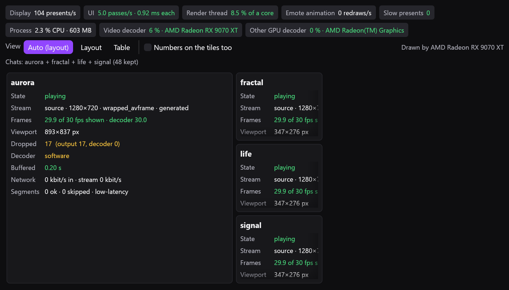
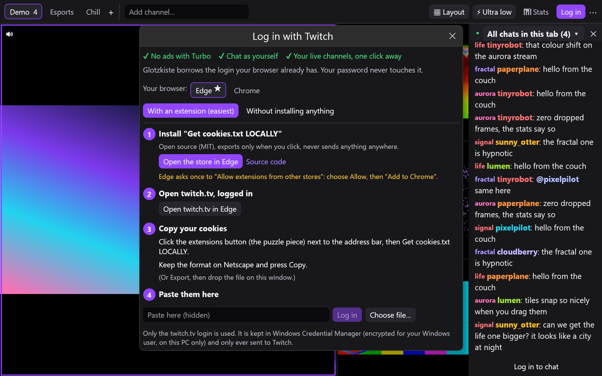

  

<h1 align="center">Glotzkiste</h1>

<b>Many live streams and chats at once. Fast, close to live, no ads with Turbo.</b> 
For Windows. Free and open source.

  <a href="https://github.com/rennerdo30/glotzkiste/releases/latest">Download</a> ·
  <a href="CHANGELOG.md">Changelog</a> ·
  <a href="https://github.com/rennerdo30/glotzkiste/issues">Report a problem</a>

*Glotzkiste* is German for "goggle box". It plays Twitch live streams the way a multiview should work: as many as you like, side by side, each with the right quality for its tile, all on the GPU, a second or so behind the broadcaster.

## Features

- **Multiview in tabs.** Every tab is a free tile layout. Presets for grid, side by side, spotlight (one big, the rest beside it) and one-at-a-time, each with or without a chat column. Drag a tile by its top bar to move it, drag the gaps to resize, double-click to maximize.
- **Ultra-low latency.** Glotzkiste fetches the stream itself and starts at the segment that is still being encoded, streaming it into the player as it arrives. *Ultra low*, *Low* and *Smooth* modes keep the delay steady by speeding up or easing off slightly; the tile shows how far behind you are.
- **Built for speed.** Hardware decoding straight to the screen without copies, the streams' rendering spread over several threads with each frame drawn at its due time and one present per screen refresh, the interface redrawn only when something changes. Auto quality follows the tile size, keeps 60 fps where it can and steps down when a video decoder gets busy.
- **Every GPU you have.** Streams decode on your other GPUs first (an integrated one counts) and on the GPU that draws the window last, so the browser and games keep theirs. Frames travel from GPU to GPU without the CPU. A decoder that runs full hands streams on to the next; right-click a stream to pick one yourself.
- **Chat that keeps up.** 7TV, BetterTTV and FrankerFaceZ emotes (animated), badges, mentions and links. Switch a chat to any channel, or combine several channels, or every stream in the tab, into one chat.
- **No ads with Turbo.** Log in with the session your browser already has; a guide in the app walks you through it. Without Turbo, ad breaks are skipped instead of shown.
- **Stats** (F3) in their own window you can put on another screen: frames shown, drops, decoder, buffer and network per stream, laid out like your tiles or as a table, plus each GPU's video-decoder load and which GPU decodes each stream.
- **Everything comes back.** Tabs, layouts, chats, quality, volume and the window place are saved and restored.
- **Updates itself.** The installed version checks once a day and updates with one click.

| Stats in their own window | Logging in |
|---|---|
|  |  |

## Install

Download from the [latest release](https://github.com/rennerdo30/glotzkiste/releases/latest):

- **Setup** (`glotzkiste-<version>-setup.exe`): installs for your Windows user only, no admin rights. Adds a Start menu entry (and a desktop shortcut if you like) and keeps itself up to date.
- **Portable** (`glotzkiste-<version>-windows-x64.zip`): unpack anywhere and start `glotzkiste.exe`. Nothing to install; keep `libmpv-2.dll` next to it.
- **With Cargo:** `cargo install glotzkiste` builds it from [crates.io](https://crates.io/crates/glotzkiste). It needs `libmpv-2.dll` next to `glotzkiste.exe` (in `%USERPROFILE%\.cargo\bin`) or on your `PATH`: take it from the portable zip. Updates come with `cargo install glotzkiste` again (the in-app updater serves the setup only).

Windows 10 or 11, 64-bit, a CPU with AVX2 (most from 2015 on) and a GPU with Direct3D 11. The setup is not code-signed yet, so Windows may warn on first run: *More info*, then *Run anyway*. Every release lists the SHA-256 of its files in `SHA256SUMS.txt`.

## Use

Type a channel name (or paste a channel link) into **Add channel…** and press Enter, or press 🎲 to fill the tab with random live streams (any number, optionally one category and language). Click a stream to hear it; the one you hear has a purple frame. Hover a stream for its quality, volume, chat and close buttons.

| Keys | |
|---|---|
| Ctrl+T, Ctrl+W | New tab, close tab |
| Ctrl+1…9, Ctrl+Tab | Switch tabs |
| Double-click, Esc | Maximize a tile in its tab, back |
| F3 | Stats |
| Ctrl+Shift+U | Install an available update |

**Logging in** gives you ad-free streams with Turbo, chat as yourself and your live followed channels. The *Log in* button explains both ways: the open-source [Get cookies.txt LOCALLY](https://github.com/kairi003/Get-cookies.txt-LOCALLY) extension (copy, paste), or copying the `auth-token` cookie from the browser's developer tools. The login is kept in Windows Credential Manager as `Glotzkiste/twitch`, encrypted for your Windows user, and is only ever sent to Twitch.

**Command line:** `glotzkiste [options] [channel…]`; channels given here open in a new tab. `glotzkiste --help` lists the options, for example `--demo` (generated streams and a sample chat, no account or network needed).

## How fast?

Measured on a Ryzen 9 9950X3D2 with a Radeon RX 9070 XT, release build, 1600×900 window:

| | |
|---|---|
| First picture after the stream URL is known | about 0.2 s |
| Delay behind what Twitch delivers | 0.2–0.6 s buffered |
| 4 streams + chat, render thread | 4 % of one CPU core, 0.4 ms per interface update |
| Dropped frames, single 1080p60 stream | 0 |

Twitch itself adds its usual one to two seconds between the broadcaster and its servers.

## Building

Rust (the version in `rust-toolchain.toml`) on Windows. `scripts\package.ps1` builds the release exe and makes the setup, zip and checksums with the pinned libmpv; see [`docs/RELEASING.md`](docs/RELEASING.md) and the architecture in [`docs/DESIGN.md`](docs/DESIGN.md).

## Licence

Glotzkiste is released under the [MIT licence](LICENSE). It uses libmpv and FFmpeg (LGPL 2.1 or later) as the separate `libmpv-2.dll` next to `glotzkiste.exe`, which you may replace with your own build. Details and the source offer are in [`licenses/libmpv-NOTICE.txt`](licenses/libmpv-NOTICE.txt); the Rust crates it uses are listed in `THIRD-PARTY-NOTICES.txt` in every release.

Glotzkiste is an independent project. It is not affiliated with or endorsed by Twitch, 7TV, BetterTTV or FrankerFaceZ; their names refer only to the services it connects to.
